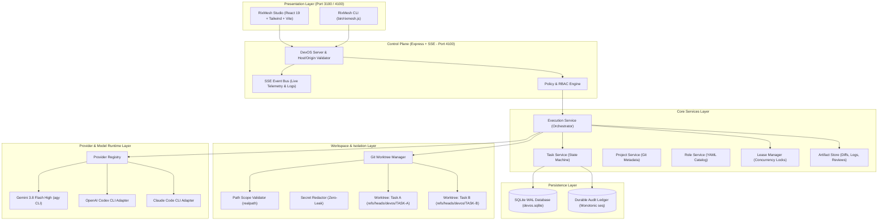
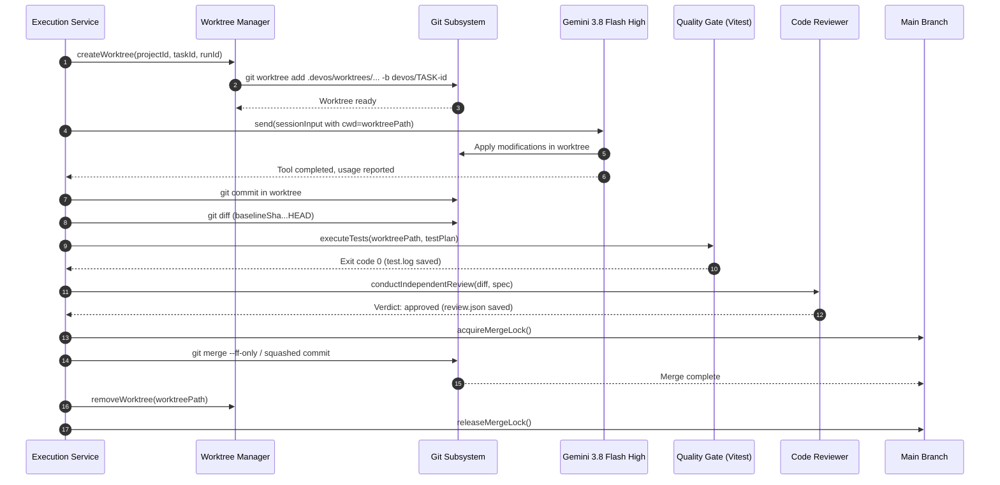

# RixMesh Architecture & Technical Design Specification

> **Version:** `0.1.0-alpha.1`  
> **Status:** Active / Production Foundation  
> **Author:** RixMesh Engineering Core (`rixed318`)  
> **Target Audience:** Systems Architects, Senior Software Engineers, Security Auditors

---

## 1. Executive Summary & Design Principles

**RixMesh** is a local-first, multi-agent software engineering operating system and control plane. It is designed to replace fragile single-prompt LLM chat sessions with a disciplined, deterministic multi-agent development workflow.

Unlike typical wrapper UIs, RixMesh enforces rigorous software engineering invariants:
1. **Physical Workspace Isolation:** Agents never write directly to the working branch. Every execution occurs inside an isolated Git worktree (`refs/heads/devos/TASK-{id}`).
2. **Topological Task Scheduling:** Tasks are arranged as a Directed Acyclic Graph (DAG) resolved via Kahn's algorithm, preventing race conditions and circular dependencies.
3. **Mandatory Quality Gates:** No code is merged into the mainline branch without passing automated verification tests and an independent peer review by a separate read-only agent.
4. **Provider Neutrality:** The orchestrator communicates through a standardized coding-agent protocol. While **Gemini 3.8 Flash (High)** serves as the primary engine via local CLI subscription, engines such as OpenAI Codex CLI, Anthropic Claude Code, and OpenCode plug in via the same lifecycle contract.
5. **Zero-Dependency Native Persistence:** Leverages Node.js 24's native `node:sqlite` (DatabaseSync) in Write-Ahead Logging (WAL) mode for low-overhead local persistence with zero C++ compilation dependencies.

---

## 2. High-Level Architecture Diagram



---

## 3. Core Subsystems

### 3.1 Orchestration & Topological DAG Scheduler (`packages/orchestrator`)

Complex software engineering initiatives are decomposed into tasks with explicit dependency edges (`dependsOnTaskIds`). The DAG scheduler computes the execution order using Kahn’s topological sort algorithm:

```typescript
// packages/orchestrator/src/dag-scheduler.ts
export class DagScheduler {
  public static computeTopologicalOrder(tasks: Task[]): {
    order: string[];
    parallelBatches: string[][];
    hasCycle: boolean;
  }
}
```

- **Cycle Detection:** Detects circular references before any agent execution begins.
- **Parallel Batching:** Identifies tasks that have zero unfulfilled dependencies and distinct write scopes, enabling safe concurrent dispatch across parallel Git worktrees.
- **Write-Scope Collision Prevention:** Two tasks with overlapping `writeScope` (e.g., both targeting `apps/server/**`) are serialized rather than executed concurrently, eliminating merge conflicts at source.

### 3.2 Git Worktree Isolation & Concurrency (`packages/workspaces`)

Each active task run is allocated a dedicated, physically isolated Git worktree:
- **Location:** `.devos/worktrees/task-{taskId}-{runId}`
- **Branch:** `refs/heads/devos/{taskId}` created from the project’s default branch HEAD.
- **Fail-Safe Invariant:** If `git worktree add` fails (e.g., branch locked or disk error), the task terminates immediately with status `FAILED`. Under **no circumstances** does execution fall back to the project root directory (`project.rootPath`).



### 3.3 Task Lifecycle State Machine

A task transitions through a strictly deterministic set of states:

```
[DRAFT]
   │
   ▼
[SPECIFIED] ──► [APPROVAL_REQUIRED] (if role requires human sign-off)
   │                      │
   ▼                      ▼
[READY] ◄─────────────────┘
   │
   ▼
[QUEUED] ──► [RUNNING] (Agent active in isolated worktree)
                │
                ├──────────────────────────────┐
                ▼                              ▼
          [VERIFYING] (Automated Tests)    [FAILED] / [CANCELLED]
                │
                ├──────────────────────┐ (Tests failed)
                ▼                      ▼
         [REVIEW_PENDING]          [FAILED]
                │
                ├──────────────────────┐ (Review rejected)
                ▼                      ▼
          [MERGE_READY]             [REWORK] (Sent back to developer)
                │
                ▼ (Sequential merge lock)
             [DONE]
```

### 3.4 Provider Protocol & Gemini 3.8 Flash High Integration (`packages/providers`)

RixMesh interacts with LLMs through the `CodingAgentAdapter` interface:

```typescript
export interface CodingAgentAdapter {
  id: string;
  probe(): Promise<ProviderProbeResult>;
  createSession(input: AgentSessionInput): Promise<AgentSession>;
  send(session: AgentSession): AsyncIterable<AgentEvent>;
  cancel(sessionId: string): Promise<void>;
  close(sessionId: string): Promise<void>;
}
```

#### Gemini 3.8 Flash High Implementation Details
1. **Engine Selection:** Executes via the local Google Antigravity CLI binary (`agy`) powered by the user's active Google account subscription.
2. **Subprocess Arguments:**
   ```bash
   agy -p "<prompt>" --model gemini-3.8-flash-high --effort high --new-project --dangerously-skip-permissions --output-format stream-json
   ```
3. **Environment Sanitization:** Host IDE variables (`ANTIGRAVITY_*`, `AGY_*`) are stripped before spawn to prevent recursive session hijacking and ensure fast (~6s) turn cycles.
4. **Event Streaming:** Captures raw stdout JSON lines, yielding structured events:
   - `message_delta` (reasoning thought stream & explanations)
   - `tool_started` / `tool_completed` (file edits, bash execution)
   - `usage_reported` (exact `tokensPrompt`, `tokensCompletion`, `thinkingTokens`, calculated `costUsd`)
   - `finished` (`status: completed` or `status: failed`)
5. **No Silent Mock Fallback:** When a provider is not installed or configured in user mode, `ProviderRegistry.resolveProvider()` throws a descriptive actionable error. Mocks are restricted strictly to unit tests (`allowMock: true`).

---

## 4. Security Architecture & Threat Defenses

| Threat Vector | Mitigation Strategy | Implementation |
|---|---|---|
| **Symlink Directory Traversal Escape** | `fs.realpath` canonicalization check before any read/write | `PathScopeValidator.validateScope()` |
| **DNS Rebinding & Host Header Poisoning** | Express middleware restricts `Host` header to `localhost` and `127.0.0.1` | `apps/server/src/server.ts` |
| **CORS Exploitation** | Whitelists only local loopback origins (`localhost`, `127.0.0.1`) | `cors()` middleware in `server.ts` |
| **Credential & Secret Leaks** | Multi-pattern regex engine redacts AWS, GCP, GitHub, JWT, SSH, and private keys from all logs, artifacts, diffs, and SSE streams | `SecretRedactor.redact()` |
| **Unauthorized Action Execution** | Declarative YAML role permissions checked against `PolicyEngine` before task execution | `PolicyEngine.evaluateAction()` |
| **Main Branch Corruption** | Parallel tasks execute exclusively in Git worktrees; merge requires positive review verdict | `GitWorktreeManager` + `ExecutionService` |

---

## 5. Persistence & Schema Architecture

Database engine: Node.js 24 native `node:sqlite` (`DatabaseSync`).

### Key Pragmas:
```sql
PRAGMA journal_mode = WAL;
PRAGMA synchronous = NORMAL;
PRAGMA foreign_keys = ON;
```

### Table Definitions:
- `projects`: Git repository roots, default branches, stack types.
- `tasks`: Full metadata, parent DAG dependencies (`depends_on_task_ids_json`), assigned roles, priority, current status, test plan.
- `runs`: Run instances, associated worktree paths, baseline commit SHAs, model engine used, usage JSON (tokens & cost).
- `audit_events`: Durable event ledger with strictly monotonic sequential IDs per project (`SELECT COALESCE(MAX(seq), 0) + 1 FROM audit_events WHERE project_id = ?`).
- `approvals`: Human-in-the-loop decisions for dangerous operations (e.g. force push, production deployment).
- `reviews`: Independent peer review verdicts, line-level feedback, and approval status.

---

## 6. Comparative Foundation Analysis

Before building RixMesh, an exhaustive comparative spike evaluated existing open-source agent platforms:

| Metric / Dimension | T3 Code | Orca | Emdash | Paseo | **RixMesh** |
|---|---|---|---|---|---|
| **Upstream Pinned SHA** | `a9e709f15f...` | `bdeb388d75...` | `9346e91309...` | `d92495487f...` | *(Native Platform)* |
| **Git Worktree Isolation** | Partial | No | Yes | Partial | **Yes (Full lifecycle & fail-safe)** |
| **Topological DAG Scheduling** | No (Sequential) | No | No | No | **Yes (Kahn's parallel DAG)** |
| **Independent Code Review Gate** | No | No | No | No | **Yes (Mandatory separate agent)** |
| **Multi-Provider Engine** | Ollama / Open-source | Claude only | Multi-LLM | Multi-LLM | **Gemini 3.8 Flash High, Codex, Claude, OpenCode** |
| **Persistence Engine** | Electron FS | SQLite | JSON | PouchDB | **Native `node:sqlite` WAL (Node 24)** |
| **Path Traversal / `realpath` Defense** | Basic | None | Basic | None | **Exhaustive canonicalization** |

See [docs/research/foundation-comparison.md](../research/foundation-comparison.md) for complete benchmark details and license notices.

