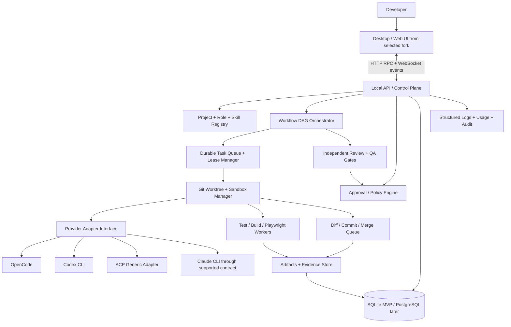

# Rixed DevOS — архитектурное исследование и техническое задание на реализацию

**Дата исследования:** 7 ноября 2026 г.  
**Статус:** архитектурный baseline; не результат локального тестирования указанных репозиториев.  
**Назначение:** рабочий документ для ведущего исполнительного coding agent и разработчиков.  
**Стратегия:** local-first мультиагентная платформа разработки, вдохновлённая концепцией Antigravity, на основе юридически допустимых open-source компонентов и подключаемых CLI-агентов.

---

## 0. Исполнительное резюме: что строить

Разработать единое desktop/web-приложение, которое управляет несколькими AI-агентами с разными ролями и зонами ответственности. Программа принимает запрос человека, создаёт спецификацию, разбивает её на задачи с зависимостями, распределяет задачи между агентами, выделяет каждому изолированную Git-worktree и ограниченный runtime, собирает результаты (patch, тесты, скриншоты, логи, документацию), проводит независимое ревью/QA и предлагает человеку безопасно объединить изменения.

**Не разрабатывать с нуля: редактор кода, LLM-модель, автономный coding CLI, Git-движок, браузерный automation engine.** Использовать существующие решения там, где лицензия и API это позволяют.

**Первый кандидат для форка интерфейса:** [T3 Code](https://github.com/pingdotgg/t3code) (MIT).  
**Альтернативные кандидаты, которые обязательно запустить на тестовой машине и сравнить:** [Orca](https://github.com/stablyai/orca) (MIT), [Emdash](https://github.com/generalaction/emdash) (Apache-2.0), [Paseo](https://github.com/getpaseo/paseo) (Apache-2.0).  
**Primary coding engine:** [OpenCode](https://github.com/anomalyco/opencode) (MIT); дополнительные адаптеры: Codex CLI, Claude Code CLI (без форка закрытого продукта), ACP-совместимые агенты.  
**Role/process design:** BMAD, gstack, Superpowers, wshobson/agents, Compound Engineering.  
**Change specs:** OpenSpec; для крупных проектов процесс Spec Kit.  
**Workflow design:** Archon и Gas City/Gas Town; задачи с зависимостями по концепции Beads.  
**Validation:** Git + тесты/линтеры + Playwright MCP + независимый reviewer.  
**Безопасность:** worktree для изоляции состояния Git **не является security sandbox**; для выполнения потенциально опасных команд нужен контейнер/отдельная ОС-изоляция.

### Предположения для MVP

1. Продукт сначала разрабатывается для **одного локального разработчика**, позднее — для команд и возможного коммерческого выпуска.
2. Первичная целевая ОС — Linux; на Windows поддерживать WSL2 как backend окружение; macOS — по мере возможностей выбранного UI-фреймворка. Статус поддержки уточнить во время прототипирования.
3. Основной язык нового backend — TypeScript/Node.js, если форк T3 Code подтвердит пригодность. SQLite в single-user MVP; PostgreSQL — на этапе командного/серверного режима. Новую технологию добавлять только за конкретную пользу.
4. Модели и подписки пользователя **не считаются автоматически бесплатными, безлимитными или разрешёнными для перепродажи**. Работать через документированные интерфейсы выбранных CLI/API; не извлекать токены из браузера и не обходить биллинг.
5. Платформа должна быть способна работать с нулём доступных cloud API, если установлен и настроен локальный/подписочный агент, но ограничения такого режима нужно показывать явно.

---

## 1. Репозитории — проверенный shortlist

Перечень нацеленно разделён по функциональным слоям. Количество GitHub Stars быстро меняется и **не используется как единственный критерий**. Лицензии ниже — ориентир по публичным репозиториям на дату анализа, а не юридическая гарантия для произвольного git commit; обязательна проверка в конкретном checkout.

### 1.1. IDE и диспетчер задач/агентов

| Репозиторий | Задача | Предварительная лицензия | Рекомендация |
|---|---|---|---|
| [pingdotgg/t3code](https://github.com/pingdotgg/t3code) | UI control plane для coding agents, Git/diff/сессии | MIT | **BASE CANDIDATE A**; форк после спайка |
| [stablyai/orca](https://github.com/stablyai/orca) | Параллельные агенты, worktrees, subagents, удалённое управление | MIT | **BASE CANDIDATE B**, архитектурный эталон |
| [generalaction/emdash](https://github.com/generalaction/emdash) | Desktop orchestration, worktrees, SSH, reviews | Apache-2.0 | **BASE CANDIDATE C** |
| [getpaseo/paseo](https://github.com/getpaseo/paseo) | Daemon + desktop/web/mobile clients, ACP/native adapters | Apache-2.0 | **BASE CANDIDATE D**, эталон provider layer |
| [OpenHands/OpenHands](https://github.com/OpenHands/OpenHands) | Autonomous coding execution, agent server, sandbox | MIT | Эталон autonomous engine/remote executor |
| [ParadevAI/Paradev](https://github.com/ParadevAI/Paradev) | Параллельная разработка, worktree, reviewing | MIT в текущем репо | UI reference; отдельно проверить ОС и безопасность |
| [OrchestratorInc/agent-orchestrator](https://github.com/OrchestratorInc/agent-orchestrator) | Агентские задачи до PR | Apache-2.0 | Изучить execution-to-PR процесс |
| [BloopAI/vibe-kanban](https://github.com/BloopAI/vibe-kanban) | Доска задач и worktree UI | Apache-2.0 | **REFERENCE ONLY**: проект объявил о завершении |

**Решение по форку:** сначала сделать техническое сравнение четырёх основных кандидатов. Форкнуть ОДНУ оболочку, а остальные хранить отдельными reference checkouts. Не смешивать целиком frontend/backend нескольких систем, поскольку разные scheduler, состояние, IPC, auth и update каналы приведут к трудно поддерживаемому монолиту.

### 1.2. Orchestration, work DAG, долговременное состояние

| Репозиторий | Сильная сторона | Использование |
|---|---|---|
| [coleam00/Archon](https://github.com/coleam00/Archon) | YAML workflows: actions, subprocess, loops, approval/wait | Архитектурный эталон workflow runtime; возможно интеграция модуля |
| [ruvnet/ruflo](https://github.com/ruvnet/ruflo) | Multi-agent swarm, MCP, memory | Изучить и выбрать конкретные функции, не встраивать весь комплекс |
| [gastownhall/gastown](https://github.com/gastownhall/gastown) | Роли Mayor/Polecat/Witness/Refinery, watchdog/merge | Дисциплина специализированных ролей и восстановление задач |
| [gastownhall/gascity](https://github.com/gastownhall/gascity) | Конфигурируемая агентская фабрика, шаги и роли | Эталон configurable orchestration |
| [gastownhall/beads](https://github.com/gastownhall/beads) | Persistent task graph, blockers, dependencies, долговременный контекст | Схема данных, зависимостей и очереди готовых задач |
| [langchain-ai/langgraph](https://github.com/langchain-ai/langgraph) | Durable execution и graph-driven agents | Альтернатива если выбирается Python engine; **не добавлять параллельно второму scheduler без причины** |

### 1.3. Process, roles, specs, coding discipline

| Репозиторий | Сильная сторона | Приоритет |
|---|---|---|
| [Fission-AI/OpenSpec](https://github.com/Fission-AI/OpenSpec) | Lightweight change proposal/specs/design/tasks в репозитории | **P0 — формат change spec** |
| [github/spec-kit](https://github.com/github/spec-kit) | Specify/plan/tasks/implement, формальные входные артефакты | P1 — режим сложных проектов |
| [bmad-code-org/BMAD-METHOD](https://github.com/bmad-code-org/BMAD-METHOD) | Analyst/PM/Architect/Dev роли и рабочие процессы | **P0 — каталог ролей** |
| [garrytan/gstack](https://github.com/garrytan/gstack) | CEO/designer/engineering manager/reviewer/QA/security/release | P1 — специальные инструкции |
| [wshobson/agents](https://github.com/wshobson/agents) | Переносимые agent personas/skills для разных CLI | **P0 — role/skill registry** |
| [obra/superpowers](https://github.com/obra/superpowers) | TDD, review gates, subagent development | **P0 — quality policy** |
| [EveryInc/compound-engineering-plugin](https://github.com/EveryInc/compound-engineering-plugin) | Knowledge capture, review/improvement loop | P1 — memory feedback |
| [affaan-m/ECC](https://github.com/affaan-m/ECC) | Обширные стандарты, memory, security, contexts | P2 — выборочные skills после тестов |

Не переносить все prompts «как есть». Любой skill должен иметь версию, назначение, ожидаемый эффект и проверку на конфликт с системными политиками. Прежде чем включать новый prompt глобально — выполнить regression suite.

### 1.4. Coding runtimes, protocols, IDE tools

| Репозиторий | Использование |
|---|---|
| [anomalyco/opencode](https://github.com/anomalyco/opencode) | Open source coding runtime для MVP; multi-provider |
| [openai/codex](https://github.com/openai/codex) | Внешний coding CLI/agent; подключить по поддерживаемому контракту |
| [Aider-AI/aider](https://github.com/Aider-AI/aider) | Repo map, edit flows, Git assistant; опциональный агент или эталон индексирования |
| [Kilo-Org/kilocode](https://github.com/Kilo-Org/kilocode) | Расширяемый coding-agent reference |
| [cline/cline](https://github.com/cline/cline) | Референс инструментов и approvals |
| [agentclientprotocol/typescript-sdk](https://github.com/agentclientprotocol/typescript-sdk) | ACP: клиент ↔ coding agent; стабильная версия протокола |
| [modelcontextprotocol/servers](https://github.com/modelcontextprotocol/servers) | MCP: tools ↔ coding agent |
| [microsoft/monaco-editor](https://github.com/microsoft/monaco-editor) | Browser-compatible editor |
| [microsoft/playwright-mcp](https://github.com/microsoft/playwright-mcp) | UI/browser E2E |
| [e2b-dev/E2B](https://github.com/e2b-dev/E2B) | Эталон удалённой изоляции execution |
| [yamadashy/repomix](https://github.com/yamadashy/repomix) | Извлечение релевантного контекста из Git проекта |
| [oraios/serena](https://github.com/oraios/serena) | Semantic code tools; **GPL-3.0-or-later для приложения**, требуется отдельная лиценз. оценка |

### 1.5. Что НЕ делать базовым кодом коммерческой платформы

- [eyaltoledano/claude-task-master](https://github.com/eyaltoledano/claude-task-master): лицензия **MIT + Commons Clause**, существенные коммерческие ограничения. Только ознакомление с принципами до разрешения юриста.
- [code-yeongyu/oh-my-openagent](https://github.com/code-yeongyu/oh-my-openagent): **Sustainable Use License**, ограничения на коммерческое распространение/хостинг. Изучение идей без встраивания исходников.
- [BloopAI/vibe-kanban](https://github.com/BloopAI/vibe-kanban): объявлено sunset, не закладывать долгосрочную поддержку на upstream.
- [anthropics/claude-code](https://github.com/anthropics/claude-code): **не трактовать как полноценную открытую базу для форка**; использовать установленный официальный CLI с соблюдением условий.
- [oraios/serena](https://github.com/oraios/serena): GPL-3.0-or-later для основного приложения; отдельно запускать как optional tool, не копировать основной GPL-код в закрытый продукт без аудита. Проверить исключения и лицензии подмодулей.
- Избегать переноса чужих названий, логотипов и UI-assets без проверки товарных знаков/прав; MIT/Apache на код не гарантируют права на бренд.

---

## 2. Стратегия выбора foundation: обязательный comparative spike

### 2.1. Факторы

Взвешенные критерии для сравнения **реально собранных** T3/Orca/Emdash/Paseo:

1. Условия лицензирования и коммерческий риск — **20%**.
2. Функциональная база (multiple sessions, diffs, editor, terminal, worktrees, approvals) — **20%**.
3. Качество архитектуры и расширяемость API/агентов — **20%**.
4. Корректность multi-agent isolation/состояния/рестарта — **15%**.
5. Поддержка Linux/Windows WSL2/macOS — **10%**.
6. Качество тестов, CI, документации, активность поддержки — **10%**.
7. Размер и стоимость дальнейшей поддержки — **5%**.

Это не готовые измеренные баллы: исполнитель обязан зафиксировать результаты локального испытания и оценить объективно по шкале 0–5 с доказательствами, включая ссылки на конкретные файлы и коммиты.

### 2.2. Минимальный спайк для каждого кандидата

- Зафиксировать upstream URL, конкретный SHA, LICENSE/NOTICE, package manager, package versions, дату последнего commit, CI status, release history.
- Собрать и запустить проект на целевой ОС без отключения проверок безопасности.
- Подключить **OpenCode** и **Codex CLI** или выполнить поддерживаемый dummy provider. Указать ограничения.
- Запустить два независимых задания на **одном тестовом репозитории** с разными worktrees.
- Посмотреть raw events и последовательность завершения, а не только красивый UI.
- Проверить ошибки: отмена агента, зависание CLI, восстановление после рестарта, collision edits.
- Посмотреть, сколько backend core надо переписывать для role manifests, DAG, review gates и audit log.
- Записать вывод и причины отклонения кандидатов в `docs/architecture/ADR-0001-foundation.md`.

### 2.3. Правило принятия решения

Пока не доказано обратное, выбирать **T3 Code** благодаря пригодной для расширения control-plane модели. Если тест докажет, что для наших workflow нужно переписать ядро или нет приемлемой поддержки целевой ОС, перевыбрать базу на **Paseo/Orca/Emdash**. Не делать необратимую миграцию до фиксации ADR.

---

## 3. Функциональный контракт платформы

### FR-01. Workspace и проекты

Платформа открывает локальный Git-проект, определяет стек, тестовые команды, package manager, рабочие ветки, AGENTS.md и доступные модели. Несколько проектов одновременно. Каждый проект хранит `project_profile`, изоляцию секретов, разрешённые tools, свою базу знаний и стоимость работ.

### FR-02. Каталог ролей

Каждая роль имеет: slug, purpose, model preferences/fallbacks, permissions, capabilities, allowed path patterns, required inputs, output schema, quality gates, skills and maximum autonomy. Роли можно создавать, клонировать, включать и выключать; конкретная задача определяет допустимые роли и численность.

### FR-03. Разбиение задач и зависимости

Planner превращает цель в DAG задач. Каждая задача имеет `depends_on`, `acceptance_criteria`, `write_scope`, `estimated_effort`, `risk_level`, `test_plan` и `artifact_contract`. Scheduling учитывает зависимости и блокировки на изменяемые файлы.

### FR-04. Параллельная работа

Согласованное выполнение нескольких независимых задач при разных worktrees; запрещать одновременную запись в одну и ту же ветку и автоматическое слияние конфликтующих изменений. Зависимые задачи ставить в очередь. UI показывает owner и блокирующие связи.

### FR-05. Устойчивость и восстановление

После crash/restart видны все задачи и сессии. Состояния хранятся в транзакционной БД; heartbeat/lease на выполнение; orphaned sessions переходят в recovery либо waiting_manual, а не бесследно теряются. Повторное выполнение не должно случайно создавать дубликаты коммитов/PR.

### FR-06. Provider independence

Встроенный адаптер OpenCode, затем Codex, затем ACP generic. Claude Code подключать через поддерживаемый внешний CLI по правилам вендора. Пользователь выбирает модель/агента для каждой роли, видит недоступных провайдеров с причиной, не вводит секреты в chat history.

### FR-07. Review & QA

Изменения нельзя считать готовыми, пока не выполнены соответствующие автоматические проверки; изменения высокого риска требуют независимого агента-reviewer и/или человека. Review результата не должен выполняться как самооценка тем же агентом в той же сессии.

### FR-08. Документы и память

Проектные документы — Markdown в Git; задачи, логи и execution metadata — в БД. Сессионная память отделена от долговременной. Эпизод/lesson попадает в permanent knowledge только после ревью, со ссылкой на task, commit и evidence. Нельзя выдавать сгенерированный факт за подтверждённый.

### FR-09. Artifacts

Для каждой завершённой задачи сохранять: summary, changed files, diff, commits, commands/tests with exit codes, screenshots if UI, review decision, docs update, unresolved issues, known risks. Artifacts доступны из task card.

### FR-10. Human-in-the-loop

Точки согласования: изменение спецификации/архитектуры с высоким влиянием, рискованный shell command, сеть/внешние интеграции, secrets, Git push/merge/main branch, release, deletion, migrations. Уровни автономности configurable; default безопасный.

### FR-11. Показ стоимости

Показывать расходы API (при наличии данных), approximate tokens, latency, tool invocations, model name. Если используется подписочный CLI, которому неизвестна фактическая стоимость, писать **«стоимость неизвестна/учитывается у провайдера»**, а не «0 ₽».

### FR-12. UX

Главная панель: проекты, Kanban/DAG, активные агенты, краткие артефакты, approvals; проект: editor/file tree, terminal, diff review, test results, timeline; отдельные вкладки Roles, Skills, Models, Memory, Cost, Settings.

---

## 4. Нефункциональные требования

- **NFR-01.** Безопасность by default: нет глобального бесконтрольного `--dangerously-skip-permissions` и аналогов; запрет auto-execute непроверенных репозиториев.
- **NFR-02.** Single-user MVP без обязательной облачной авторизации, без открытого внешнего network listener по умолчанию.
- **NFR-03.** Миграции БД должны быть атомарными и versioned.
- **NFR-04.** Каждая операция traceable: actor, user/task/run id, code SHA, timestamp, policy decision, result.
- **NFR-05.** Полноценная работа офлайн для ранее установленного/авторизованного локального coding engine; cloud agents могут не работать.
- **NFR-06.** Операции с Git обратимы, если пользователь не подтвердил иное. Никаких скрытых `reset --hard`/`clean -fd`.
- **NFR-07.** Отказы отдельных агентов не должны валить server/UI.
- **NFR-08.** Разрешения доступа к файлам и инструментам enforce на уровне среды исполнения, не только в prompt.
- **NFR-09.** Процессы, subprocess trees, контейнеры завершаются при cancellation; orphan cleanup работает после рестарта.
- **NFR-10.** Каждый потенциально долговременный процесс имеет retry/backoff/timeout/max-attempts; повторять только идемпотентные операции.

---

## 5. Целевая архитектура



### Границы компонентов

**UI/Control Plane:** не должен решать, какой shell command безопасен; только визуализация и запросы к API. Backend — единственный источник истины по состоянию.

**Workflow Orchestrator:** владеет DAG, task lease, идемпотентностью, retry, completion criteria, approval waits. Никаких скрытых «агент сам кому-то написал в соседний чат» без регистрируемого события.

**Provider Adapter:** взаимодействует с внешним coding CLI; нормализует streaming text, tool invocation, permission requests, usage, errors, conversation ids, resumes. Поддержку возможностей раскрывать capability flags; недоступные функции не притворяться поддерживаемыми.

**Git Workspace Manager:** создаёт branch/worktree на task, фиксирует baseline SHA и ограничения области записи. Основной рабочий каталог никогда не меняется чужим агентом автоматически. Изменения интегрируются после gates.

**Sandbox/Policy:** обеспечивает actual filesystem/network/process restrictions где это возможно. Worktree — только Git isolation; для dangerous/untrusted work применять контейнер или ОС-механизм sandbox.

**Knowledge Service:** управляет canonical docs, contextual retrieval, vetted decisions and reusable lessons. Связан с задачами и версиями кода.

**Review Engine:** оценивает тесты, schema compliance, build, code analysis, human approvals. Невыполненные требования — не «предупреждение», а gate failure согласно policy.

---

## 6. Роли агентов

| Роль | Ответственность | Разрешённые изменения | Обязательный артефакт |
|---|---|---|---|
| **Orchestrator** | Распределение задач, блокировок, модель/бюджет, ретраи, эскалации | Метаданные workflow, **не произвольный код** | task DAG, decisions, timeline |
| **Product Analyst** | Сбор требований, edge cases, цели | `docs/specs/**`, `openspec/**` | PRD/change proposal + acceptance criteria |
| **Software Architect** | Компоненты, API-контракты, риски, ADR | `docs/architecture/**`, interfaces с approval | ADR, design, dependency map |
| **Task Planner** | План этапов, task DAG, критерии | Task state через API | JSON/YAML DAG |
| **UI/UX Designer** | User flows, дизайн-решения, состояния | UI specs, дизайнерские ресурсы | UI spec/screens state list |
| **Frontend Developer** | UI, состояние клиента, frontend tests | frontend paths | Patch, screenshots, tests |
| **Backend Developer** | Domain logic, RPC/API, DB migrations | backend paths | Patch, API contract, tests |
| **QA Engineer** | Unit/integration/e2e, negative tests | tests, fixtures; issues | Repro steps, test results |
| **Code Reviewer** | Независимое ревью, defects/security/performance | По умолчанию read-only | review JSON: approve/request_changes/block |
| **Security Auditor** | Permissions, secrets, deps, injections, shell/network | read-only, approved policy changes | threat findings with severity/evidence |
| **Documentation Engineer** | README, API docs, release notes | docs paths | Updated docs and change log |
| **DevOps/Release** | Build, CI, packaging, release check | `.github/**`, `scripts/**`, infra paths | release checklist + build manifests |

**Правило экономии ресурсов:** не запускать весь штат на каждую задачу. Для простого bugfix достаточно Planner (или уже согласованный ticket) → Developer → QA/reviewer. Для security-sensitive или breaking-change — Architect/Security/Human mandatory.

**Документация:** роли ведут собственные execution notes, но проект имеет **единые canonical** specs/ADRs/README. Не допускать 10 расходящихся «истин» по одному решению. История агента не равна актуальной документации проекта.

---

## 7. Role manifest и выходной контракт

Пример `roles/backend-developer.yaml` (схема подлежит реализации через Zod/JSON Schema):

```yaml
apiVersion: devos/v1
kind: AgentRole
metadata:
  name: backend-developer
  version: "1.0.0"
spec:
  purpose: "Implement backend changes from approved design and ticket"
  compatibleProviders: [opencode, codex, acp]
  modelPolicy:
    tier: balanced
    allowFallback: true
  autonomy: workspace-write
  limits:
    maxConcurrentTasks: 1
    maxAttempts: 2
    wallClockMinutes: 45
    estimatedBudgetUsd: 3.00
  permissions:
    read: ["**/*"]
    write: ["apps/api/**", "packages/shared/**", "tests/backend/**"]
    forbidden: [".env*", "secrets/**", ".git/**"]
    tools: [file-read, file-write, test-run, git-status, git-diff]
    network: denied
    approvalRequired: [git-push, git-merge, db-prod-migration]
  requiredInputs: [ticket, acceptanceCriteria, approvedDesign, baselineCommit]
  skills: [tdd, structured-handoff, error-handling]
  outputSchema: devos.task-result.v1
  review:
    requireIndependentReviewer: true
    requireAutomatedTests: true
```

**Важно:** globs выше — интерфейс policy, но реальная проверка write-boundaries должна осуществляться в runtime/монтированиях/последующей проверке diff. Prompt сам по себе запретить запись в `secrets/` не способен.

Пример `task-result.json`:

```json
{
  "schemaVersion": "1.0",
  "taskId": "TASK-104",
  "runId": "RUN-208",
  "status": "completed",
  "summary": "Added input validation to users API",
  "baselineCommit": "<sha>",
  "resultCommit": "<sha>",
  "changedFiles": ["apps/api/src/users.ts", "tests/backend/users.test.ts"],
  "tests": [
    {"command": "pnpm test:backend", "exitCode": 0, "reportPath": "artifacts/RUN-208/test.log"}
  ],
  "docsUpdated": ["docs/api/users.md"],
  "risks": [],
  "blockedBy": [],
  "evidence": ["artifacts/RUN-208/diff.patch"],
  "requiresHumanApproval": false
}
```

Поля `baselineCommit` и `resultCommit` должны содержать реальные Git SHA, не placeholders в рабочем результате. Все artifacts хранить с hash и trusted timestamp. Проверять структуру Zod/JSON Schema, не доверять свободному тексту.

---

## 8. Lifecycle, DAG, events, approvals

### 8.1. Состояния задачи

`DRAFT → SPECIFIED → APPROVAL_REQUIRED → READY → QUEUED → RUNNING → VERIFYING → REVIEW_PENDING → MERGE_READY → DONE`

Переходы ошибок: `BLOCKED`, `FAILED`, `CANCELLED`, `WAITING_USER`, `RECOVERING`. `REWORK` переходит назад в `READY`/`QUEUED` с отдельным revision и объяснением. Никогда не терять историю переходов.

Каждый transition хранит: `taskId`, `previousStatus`, `newStatus`, `eventSeq`, `reason`, `actor`, `runId`, `timestamp`, `idempotencyKey`.

### 8.2. Completion gates

- Spec gate: задача имеет конкретные measurable acceptance criteria, scopes, dependencies.
- Implementation gate: агент завершил выполнение, зафиксировал diff, result JSON, committed output или controlled patch.
- Test gate: required tests/build/linters запущены и успешно завершены, не просто «агент сказал прошли».
- Review gate: independent reviewer проверил diff относительно baseline и указал verdict.
- Merge gate: нет конфликтов, baseline совместим, approval на protected branches, есть rollback path.
- Documentation gate: изменения контрактов описаны, если это требуется.

### 8.3. Правила параллелизма

1. Scheduler выбирает только задачи, все зависимости которых DONE или имеют иные явно согласованные условия.
2. Не выдавать lock на пересекающиеся scopes без проверки конфликтов; conservative scheduling лучше незаметной порчи кода.
3. У каждого task отдельный `refs/heads/devos/TASK-{id}-{short}` и worktree.
4. Задания могут читать общие snapshot, но запись допускается только в назначенный worktree с enforce limits.
5. При merge запустить rebase/cherry-pick в отдельном integration worktree, затем повторить tests; не auto-force push.
6. При конфликте создать `MERGE_CONFLICT` task для интегратора или человека, а не перезаписать чужие изменения.

### 8.4. Durable execution

- Хранить job lease с TTL и heartbeat.
- При рестарте sweep orphaned leases, reconcile process/container status; не запускать операцию повторно без проверки side effects.
- Выход при maxAttempts с `FAILED` и полным failure report.
- `CANCEL` отключает порождение новых задач, корректно завершает процесс tree, фиксирует частичные diff/artifacts.
- `Retry` создаёт новую `runId` с сохранением прежнего failed run.

---

## 9. Протоколы и интеграция провайдеров

### 9.1. ACP vs MCP

**ACP** (Agent Client Protocol) — транспорт и API между DevOS и coding CLI (sessions, turns, permissions, progress, capabilities). Начинать со стабильной версии ACP TypeScript SDK, не зависеть от неподтверждённого draft v2.

**MCP** (Model Context Protocol) — инструменты для coding CLI: GitHub, filesystem under restrictions, browser, docs, search, task tools. MCP server — потенциально опасное расширение, доверять только через allowlist/permissions.

**Provider adapter** — отдельный слой между DevOS и конкретным CLI, поскольку не все coding CLIs реализуют ACP одинаково.

### 9.2. Интерфейс adapter (концептуально)

```ts
interface CodingAgentAdapter {
  readonly id: string;
  probe(): Promise<{ available: boolean; reason?: string; capabilities: string[] }>;
  startSession(input: {
    cwd: string;
    role: string;
    instructions: string;
    model?: string;
    envRef?: string;
    allowedTools: string[];
  }): Promise<{ sessionId: string }>;
  send(sessionId: string, message: string): AsyncIterable<AgentEvent>;
  requestPermission(sessionId: string, permissionId: string, decision: "allow" | "deny"): Promise<void>;
  cancel(sessionId: string): Promise<void>;
  resume?(sessionId: string): Promise<void>;
  close(sessionId: string): Promise<void>;
}
```

`AgentEvent` normalized union: `started`, `message_delta`, `tool_started`, `tool_completed`, `permission_requested`, `usage_reported`, `artifact_emitted`, `error`, `finished` with monotonically increasing event sequence. Raw provider-specific payload хранить отдельно с redaction.

### 9.3. Аутентификация и бюджеты

- Сначала проверка доступности установленного бинарника и documented auth; не копировать чужие OAuth tokens из UI хранилищ.
- API keys хранить в OS keychain/secret storage либо зашифрованном store с правильно управляемым ключом; не в `.env` репозитория и не в plain SQLite.
- Для каждого профиля модели `provider`, `model`, `pricingSource`, `tokenLimit`, `costBudget`, `supportsTools`, `supportsACP`, `supportsStreaming`.
- У подписочных CLI затраты могут быть неизвестны DevOS; фиксировать usage только если CLI реально отдаёт данные.
- При превышении budget: graceful stop + approval, а не молчаливое бесконечное выполнение.

---

## 10. Модель данных (SQLite MVP, совместимая с PostgreSQL)

**projects**: id, name, root_path, git_remote, default_branch, baseline_sha, stack, created_at.  
**roles**: id, slug, version, manifest_yaml, enabled, created_at.  
**skills**: id, slug, version, source_ref, checksum, scope, enabled.  
**providers**: id, adapter_type, executable, capabilities_json, auth_status, config_ref.  
**models**: id, provider_id, model_name, tier, limits_json, cost_metadata_json.  
**tasks**: id, project_id, title, spec_path, status, priority, risk, assignee_role_id, scope_json, version, created_at, updated_at.  
**task_dependencies**: task_id, depends_on_task_id, constraint_type.  
**runs**: id, task_id, provider_id, model_id, worktree_id, session_id, lease_expires_at, started_at, finished_at, exit_status, usage_json.  
**worktrees**: id, project_id, task_id, branch, path, baseline_sha, result_sha, state.  
**artifacts**: id, run_id, type, path, sha256, schema_version, created_at.  
**approvals**: id, run_id, command_or_action, reason, status, requested_at, decided_at, decided_by.  
**reviews**: id, task_id, reviewer_run_id, verdict, findings_json, created_at.  
**knowledge**: id, project_id, scope, kind, source_task_id, source_sha, body_path, reviewed_by, created_at.  
**audit_events**: id, project_id, task_id, run_id, seq, actor, type, payload_redacted_json, created_at.  
**task_leases**: task_id, run_id, lease_owner, heartbeat_at, expires_at, fencing_token.

Индексы: `tasks(project_id,status,priority)`, `task_dependencies(depends_on_task_id)`, `runs(task_id,started_at)`, `audit_events(project_id,seq)`, `task_leases(expires_at)`. Foreign keys ON, транзакции для смены статуса/leases, unique constraint на idempotencyKey transition. Предусмотреть soft delete/tombstones для важных audit records.

### API endpoints (минимум)

- `GET/POST /api/projects`, `GET /api/projects/:id`
- `GET/POST /api/projects/:id/tasks`, `GET /api/tasks/:id`, `POST /api/tasks/:id/approve`
- `POST /api/tasks/:id/start`, `POST /api/tasks/:id/cancel`, `POST /api/tasks/:id/retry`
- `GET/POST /api/roles`, `GET /api/skills`, `GET /api/providers`, `GET /api/models`
- `GET /api/runs/:id`, `GET /api/runs/:id/artifacts`, `GET /api/runs/:id/logs`
- `GET /api/projects/:id/worktrees`, `POST /api/tasks/:id/review`, `POST /api/tasks/:id/merge`
- `GET /api/events?projectId=&afterSeq=...` для replay и WebSocket `/api/events/stream` для live подписки.

Протокол можно сделать typed RPC, если так устроен выбранный fork; HTTP paths выше — semantic contract, не обязательство переписывать существующий transport.

---

## 11. Структура хранения документов и проекта

```text
<target-project>/
├── AGENTS.md                         # краткая инструкция, общая для агентов
├── .devos/
│   ├── project.yaml                  # описание проекта и политика доступа
│   ├── roles/                        # overrides ролей на уровне проекта
│   ├── workflows/                    # declarative workflow definitions
│   └── quality-gates.yaml            # тесты и политики merge
├── openspec/
│   ├── changes/<change-id>/
│   │   ├── proposal.md
│   │   ├── design.md
│   │   ├── tasks.md
│   │   └── specs/<capability>/spec.md
│   └── specs/                         # актуальные спецификации
├── docs/
│   ├── architecture/
│   │   ├── overview.md
│   │   └── ADR-0001-*.md
│   ├── api/
│   ├── runbooks/
│   ├── security/
│   └── handoffs/
├── tests/
└── src/ (или apps/, packages/ ...)
```

**Важно:** runtime DB, traces, credentials, ephemeral worktree folders and generated screenshots обычно хранить **вне рабочей Git-директории** в OS app data или в защищённом storage, а не автоматически коммитить. В Git попадают только необходимые человекочитаемые specs/ADRs и валидированные docs. Доступ к памяти ограничить scope: task/project/user; глобальную память не использовать для утечки коммерческих проектов между собой.

---

## 12. UI/UX: экранная карта

**A. Home / Projects:** список проектов, состояние Git, расходы, последние runs, кнопка Create/Open Project.

**B. Project Dashboard:** Kanban (`Backlog`, `Ready`, `In progress`, `Review`, `Blocked`, `Done`) + DAG tab. Задача кликабельна: owner, dependency, role, model, write scope, progress, estimated budget, approvals.

**C. Agent Manager:** роли карточками с состояниями `idle / active / waiting_approval / blocked / error`, ресурсами, активным task. Действия: assign, pause, stop, retry, inspect. Показывать real task work, не только чат.

**D. Task Detail:** prompt+spec, план, terminal events, files changed, code diff, tests, screenshots, reviewer comments, approvals, cost/usage; compare baseline/result.

**E. Editor:** Monaco или редактор уже выбранного форка, project file tree, editor tabs, terminals, searchable problems; Git diff review с reject/accept вручную.

**F. Roles & Skills:** visual editor YAML manifests + schema validation, included skills, version/history, permissions and default model; preview итогового system context для роли.

**G. Providers:** обнаружение локально установленных agents; список ACP-compatible; auth status; capability matrix; optional API/local model configurations.

**H. Knowledge:** версии ADR/specs/lessons, sources/commits, search, manual approve/pin; UI показывает дату последнего обновления.

**I. Policy & Settings:** autonomy level, shell/network allowlist, filesystem scopes, approval rules, budget limits, concurrency, credentials references, telemetry opt-in/off.

**J. Run Replay:** последовательный журнал событий с ссылками на доказательства; после рестарта восстанавливает тот же снимок состояния.

---

## 13. Security threat model и правила

### Threats

1. **Prompt injection** через README, search result, package docs, comments, MCP tool outputs: агент воспринимает контент как приказы.
2. **Secret exfiltration** через shell/curl, логирование API keys, env, config, ~/.ssh, cookies.
3. **Malicious npm/pip/postinstall** из скачанного repo, с доступом к хосту.
4. **Sandbox escape** или неправильные volumes, сетевой доступ к LAN.
5. **Path traversal / symlink escape** при проверке разрешённых файлов.
6. **Privilege escalation** от отдельного агента к Orchestrator или Approval Engine.
7. **Race/conflict** при параллельных writes, stale baseline, destructive merge.
8. **Supply-chain attack** через форк, непиннутые зависимости, install scripts, неизвестные MCP servers.
9. **Unbounded cost/usage** или зависший агент, который бесконечно расходует бюджет.
10. **Sensitive project leakage** через общую память, embeddings, telemetry, external tools.

### Mandatory mitigations

- Default deny на запуск shell/network вне разрешённой роли. `approve once` и `always allow` различаются, второе по умолчанию недоступно для опасных команд.
- Tool/command approvals enforce сервером, не prompts; immutable audit record.
- Container isolation с minimal read/write mounts, non-root uid, no Docker socket, explicit network allowlist; запуск untrusted code на host без sandbox запрещён.
- Для локального trusted режима без контейнера показывать предупреждение и не давать ложной гарантии безопасности.
- Canonicalize paths + realpath checks; защита от symlinks; forbid direct writes to `~/.ssh`, project secrets, Git admin dirs.
- Input/output redaction; OS secret store; permission scopes по роли и по задаче.
- Пиновать зависимости, upstream SHA, версии ACP/MCP, генерировать SBOM и проверять уязвимости перед release.
- Никаких vendor CLI bypass approval флагов в production defaults.
- Git operations с preconditions baseline SHA, no-force-push, require human approval for protected branch.
- Kill-switch: немедленно останавливает все активные runs и запускаемые child processes; лишает доступа к secrets.

---

## 14. Пошаговый план реализации и DoD

### P0 — Инвентаризация и архитектурный spike (первый обязательный этап)

**Сделать:**
- Создать новый Git репозиторий `rixed-devos` (не переписывать upstream до сравнения).
- Выполнить comparative spike T3 / Orca / Paseo / Emdash. Внутри `research/upstreams/` хранить URL/SHA/license/status/results. Каждую reference codebase держать отдельно от product.
- Зафиксировать лицензии и коммерческие ограничения; сохранить LICENSE/NOTICE, dependency licenses, trademarks risks.
- Определить desktop runtime, frontend, backend, database, plugin system, event stream.
- Написать ADR-0001 (основание), ADR-0002 (agent abstraction), ADR-0003 (worktree and sandbox), ADR-0004 (data model).

**DoD:** 4 кандидата описаны по всем критериям с реальными logs/build outcomes; указано выбранное ядро и отклонённые варианты. Любая невозможность запуска зафиксирована, а не скрыта.

### P1 — Рабочий минимальный control plane

**Сделать:**
- Fork выбранной оболочки в собственный репозиторий, создать `upstream` remote, убрать/заменить чужой branding с учётом лицензий.
- Projects, Task cards, basic logs, providers discovery (OpenCode), one agent session, Git diff, cancel.
- Typed events, SQLite migrations, event history/replay, structured logs.
- Разделить UI и backend через стабильный internal API.

**DoD:** пользователь открывает Git-проект, даёт задачу OpenCode, видит real-time logs и diff, отменяет выполнение, перезапускает UI и видит историю. Оригинальный working tree не портится.

### P2 — Роли, task graph и параллельная работа

**Сделать:**
- Role YAML registry + schema validation; 5 базовых ролей Planner, Architect, Developer, QA, Reviewer.
- DAG scheduler: dependencies, ready queue, leases, retry, human approval.
- Worktree manager per task, branch naming, write scopes, branch conflict prechecks.
- Запуск двух независимых tasks параллельно, staging/merge queue; reviewer независим.
- Adapter for Codex and generic ACP after OpenCode stable integration.

**DoD:** две независимые задачи одновременно меняют разные файлы; зависимая задача ждёт; reviewer блокирует плохой patch; collision создаёт controlled merge-conflict status; crash recovery не дублирует работу.

### P3 — Quality gates, specs, knowledge

**Сделать:**
- OpenSpec format, proposal/design/tasks, agent-generated specs → human approval → execution.
- Test/build/lint policy, Playwright UI QA, screenshot artifacts, independent review JSON.
- Project knowledge base + vetted memory; provenance source task/SHA.
- Cost/usage dashboard with unknown costs for opaque subscriptions.
- Agent skill registry (BMAD, gstack, Superpowers/others), versioning and regression suite.

**DoD:** full flow from plain-language request to reviewed code, passing real tests, updated docs, merged branch. Every gate backed by actual evidence.

### P4 — Product polish и расширение

**Сделать:**
- UX refactor, agent manager dashboards, advanced DAG/timeline, undo/revert, search/index.
- Security hardening with OS sandbox or Docker, safe execution policy by default.
- Windows WSL2 packaging/tests, macOS where feasible, install/update builds.
- Remote control optional with explicit opt-in TLS/auth, no public endpoints by default.
- Open-source attribution, release docs, license audit, SBOM, privacy and backup procedures.

**DoD:** repeatable release build with CI, rollback/recovery test, security tests, distributable legal notices, supported-platform matrix.

---

## 15. Тестовый проект для приёмки MVP

Создать sample project `devos-e2e-sample`: web UI + simple API + tests, SQLite (не использовать реальные ключи или пользовательские данные). Пользовательское задание: «Добавь список задач с созданием/переименованием/фильтрацией, REST endpoint и проверками». Planner должен создать tasks и зависимости; Frontend и Backend работают параллельно в разных worktrees; QA пишет/запускает tests; Reviewer проверяет; Docs обновляет инструкции; Integrator выполняет контролируемое слияние.

### E2E acceptance matrix

| ID | Проверка | Ожидаемый результат |
|---|---|---|
| AT-01 | Create/Open project | Прочитан Git state, created project id |
| AT-02 | Generate spec and DAG | Spec + tasks + dependency edges + acceptance criteria |
| AT-03 | Independent tasks | Два разных task работают параллельно, разные worktrees |
| AT-04 | Dependent task | Не запускается до выполнения prerequisite |
| AT-05 | Cancel run | Процессы остановлены, статус CANCELLED, artifacts не теряются |
| AT-06 | Restart server during run | Reconciliation без дублей сессий/коммитов |
| AT-07 | Failing test | MERGE blocked, failed logs видны |
| AT-08 | Independent review rejects | Merge blocked, issue returned to developer |
| AT-09 | Out-of-scope edit | Запрещена/обнаружена write violation, работа blocked |
| AT-10 | Dangerous tool request | Требует явного approval; отсутствие решения не равно allow |
| AT-11 | Secret access attempt | Доступ запрещён/не смонтирован, в логах нет секретов |
| AT-12 | Branch conflict | Без silent overwrite, отдельная resolution task |
| AT-13 | Usage budget exceeded | Run stop/wait approval, корректная статистика |
| AT-14 | Model/provider unavailable | Friendly error + explicit fallback option |
| AT-15 | Diff review / merge | Human can inspect patch; protected main unchanged without approval |
| AT-16 | Docs/knowledge | Утверждённые ADR/specs persist в Git; unverified lessons не считаются истиной |
| AT-17 | Event replay | Последовательность событий восстановлена после reload |
| AT-18 | Source attribution | LICENSE/NOTICE и pin SHA показаны в dependency inventory |

Отдельно создать benchmark из **10 стабильных задач**: 3 bugfix, 2 feature, 2 refactor, 1 UI browser test, 1 security defect, 1 failing integration. Метрики: success rate, number of human interventions, regressions after merge, median wall time, consumed calls/tokens (если доступны), number of tool failures, number of retries. Сравнить single-agent baseline против multi-agent режима **при равных тестовых условиях**; не считать количество агентов показателем полезности.

---

## 16. Предлагаемая структура самого репозитория DevOS

```text
rixed-devos/
├── apps/
│   ├── desktop/              # выбранная desktop shell (fork)
│   ├── web/                  # frontend если отдельно
│   └── server/               # local control plane
├── packages/
│   ├── domain/               # project/task/run/role types + Zod schemas
│   ├── orchestrator/         # scheduler, DAG, leases, transitions
│   ├── providers/            # OpenCode, Codex, ACP adapters
│   ├── workspaces/           # Git worktree / branches / merge queue
│   ├── sandbox/              # process/container execution isolation
│   ├── policy/               # permissions and approval engine
│   ├── artifacts/            # logs, patches, screenshots, test output
│   ├── knowledge/            # docs and approved memories
│   ├── observability/        # structured events, traces, usage
│   └── ui-components/        # reusable UI
├── roles/                    # reusable role manifests
├── skills/                   # versioned and attributed reusable skills
├── workflows/                # small-bugfix, feature, refactor, security
├── templates/                # AGENTS.md, project.yaml, specs
├── docs/
│   ├── architecture/         # ADRs
│   ├── research/             # repo inventory & comparative spike
│   ├── security/
│   └── runbooks/
├── tests/
│   ├── unit/
│   ├── integration/
│   ├── e2e/
│   └── benchmark/
└── LICENSE / NOTICE / THIRD_PARTY_NOTICES.md
```

**Структура ориентировочная:** адаптировать к выбранному upstream; не ломать monorepo только ради красоты дерева.

---

## 17. Первый запуск: исследовательские команды

Создать отдельный каталог для research checkouts (Linux/macOS/WSL bash). Команды ниже **клонируют для аудита, не форкают на GitHub**:

```bash
mkdir -p ~/rixed-devos-research/upstreams
cd ~/rixed-devos-research/upstreams

git clone --depth 1 https://github.com/pingdotgg/t3code.git
git clone --depth 1 https://github.com/stablyai/orca.git
git clone --depth 1 https://github.com/generalaction/emdash.git
git clone --depth 1 https://github.com/getpaseo/paseo.git

git clone --depth 1 https://github.com/coleam00/Archon.git
git clone --depth 1 https://github.com/gastownhall/gascity.git
git clone --depth 1 https://github.com/gastownhall/beads.git
git clone --depth 1 https://github.com/Fission-AI/OpenSpec.git
git clone --depth 1 https://github.com/bmad-code-org/BMAD-METHOD.git
git clone --depth 1 https://github.com/wshobson/agents.git
git clone --depth 1 https://github.com/obra/superpowers.git

# Inspect exact pinned commit and license of each checkout:
for dir in */; do
  echo "=== ${dir} ==="
  (cd "$dir" && git rev-parse HEAD && ls LICENSE* NOTICE* 2>/dev/null || true)
done
```

Не запускать массовые `npm install`, `postinstall`, shell-script из неизвестных forks без source audit. Сначала сравнить lockfiles, package scripts и security policy в sandbox. GitHub fork после выбора, если установлен и авторизован `gh`:

```bash
# Только после P0 и выбора foundation:
gh auth status
gh repo fork pingdotgg/t3code --clone=false
# Если выбран другой foundation, заменить имя и НЕ форкать t3code автоматически.
```

В продукте сохранить upstream remote отдельно, регулярно отслеживать security patches, но обновления форка сливать только через отдельные тесты и review.

---

## 18. Порядок работы исполнительного агента (главное распоряжение)

Ты — главный технический исполнитель проекта **Rixed DevOS**. Твоя задача — превратить это ТЗ в работающую систему, а не создать красивый README без кода.

**Жёсткие правила:**
1. Не утверждай, что репозиторий собран, функция реализована, license проверена или tests пройдены, пока не выполнил соответствующие действия. Всегда указывай ссылки на commits, команды и результаты.
2. Не создавай новые framework/scheduler/LLM backend без анализа готовых библиотек и согласованного ADR.
3. Не сливай codebases нескольких IDE «копированием папок». Выбери одну основную оболочку, создай adapter boundaries.
4. Сначала P0: архитектурный spike и лицензии; затем вертикальный MVP; только затем расширение ролей и возможностей.
5. Думай о коммерческом распространении. Избегай Task Master Commons Clause, Sustainable Use License и GPL-несовместимого заимствования без письменного разрешения.
6. Не используй команды обхода approvals/sandbox для скорости реализации. Проверки и пользовательские секреты имеют приоритет.
7. Каждый шаг должен давать работающий вертикальный slice и быть покрыт автоматическими тестами.
8. При неполной информации выбирай безопасный локальный default, фиксируй assumption в ADR и продолжай до разумного checkpoint.
9. Не выдавай непроверенные расходы моделей за нулевые и не предполагай, что обычная подписка предоставляет неограниченный API.
10. В ответе владельцу проекта предоставляй статус в виде таблицы: выполнено, доказательство, тесты, открытые риски, следующий этап.

**Непосредственное задание для первой сессии:**
- Сгенерируй P0 backlog с конечными задачами и acceptance criteria.
- Сделай лицензированный inventory repositories и их pin SHA.
- Собери/запусти T3 Code и сравни с Orca/Paseo/Emdash по rubric.
- Сделай ADR-0001 обоснование выбора платформы.
- Создай minimal local app skeleton, если этого требует выбранный upstream, и проведи P1 smoke test с одной реальной OpenCode session.
- Не переходи к масштабной реализации, пока нет демонстрации «создать задачу → запустить агента → получить diff → отменить → восстановить историю».

**Формат отчёта по результату каждого этапа:**
- Кратко: достигнутые функции и что реально работает.
- Git SHA / PR / path реализации.
- Точные команды запусков и tests, exit codes.
- Измерения и открытые проблемы.
- Security и license deltas.
- Следующие 3–7 конкретных задач в приоритетном порядке.

---

## 19. Источники для проверки

Основные первоисточники — официальные репозитории и документация. Важные пункты:

- Google Antigravity: https://antigravity.google/ ; Google Developers Blog announcements and documentation.
- T3 Code: https://github.com/pingdotgg/t3code ; LICENSE на конкретном SHA.
- Orca: https://github.com/stablyai/orca .
- Emdash: https://github.com/generalaction/emdash .
- Paseo: https://github.com/getpaseo/paseo ; Provider Model: https://paseo.sh/docs/providers ; ACP catalogue: https://github.com/getpaseo/paseo/blob/main/public-docs/supported-providers.md .
- OpenHands: https://github.com/OpenHands/OpenHands .
- OpenSpec: https://github.com/Fission-AI/OpenSpec .
- GitHub Spec Kit: https://github.com/github/spec-kit .
- BMAD: https://github.com/bmad-code-org/BMAD-METHOD .
- Gas City: https://github.com/gastownhall/gascity .
- Beads: https://github.com/gastownhall/beads .
- ACP TypeScript SDK: https://github.com/agentclientprotocol/typescript-sdk .
- MCP Servers: https://github.com/modelcontextprotocol/servers .
- OpenCode: https://github.com/anomalyco/opencode .
- Codex: https://github.com/openai/codex .
- Playwright MCP: https://github.com/microsoft/playwright-mcp .
- Task Master license: https://github.com/eyaltoledano/claude-task-master/blob/main/LICENSE .
- Oh My OpenAgent license: https://github.com/code-yeongyu/oh-my-openagent/blob/dev/LICENSE (проверить актуальную ветку в checkout).
- Vibe Kanban sunset announcement: https://github.com/BloopAI/vibe-kanban .
- Serena license: https://github.com/oraios/serena .

**Ограничение исследования:** здесь нет результатов реального сборочного аудита на целевом компьютере и benchmark; это обязанность P0. GitHub stars, license badges и README не заменяют запуск, CI status, security-review, проверку лицензий зависимостей или экономическую оценку.
